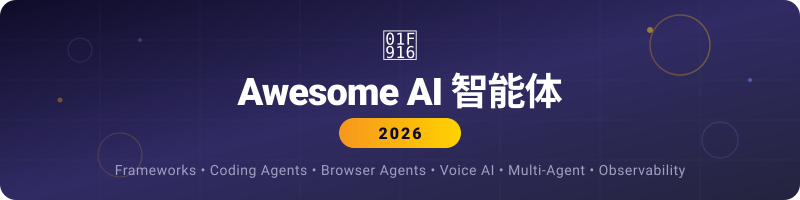

<!--lint disable awesome-heading awesome-github awesome-toc -->

  
   
  <h3>2026 年最全面的 AI 智能体、框架与工具清单。</h3>
  <h4>25+ 个分类，600+ 个资源。每月更新。</h4>

   

  <a href="#-编程智能体">编程</a> · <a href="#-智能体框架">框架</a> · <a href="#-浏览器与桌面智能体">浏览器</a> · <a href="#-语音智能体">语音</a> · <a href="#-文本与写作">文本</a> · <a href="#-创意-ai">创意</a> · <a href="#-任务与工作流智能体">工作流</a> · <a href="#-客户支持与-crm-智能体">CRM</a> · <a href="#-营销与增长-ai">营销</a> · <a href="#-数据与研究智能体">研究</a> · <a href="#-本地与自托管-ai">自托管</a> · <a href="#-llm-开发与运维">LLM 工程</a> · <a href="#-协议与标准">协议</a>

---

> **600+ 个工具。25+ 个分类。每月更新。** 点 Star 及时获取更新。[欢迎贡献！](#参与贡献)

---

## 目录

- [GNAP](https://github.com/farol-team/gnap) — Git 原生的智能体协议：用 git 仓库里的 4 个 JSON 文件协调 AI 智能体团队。无服务器、无数据库。任何能 git push 的智能体都能参与。MIT 许可。
- [编程智能体](#-编程智能体) — IDE、终端、自主开发、代码审查、应用构建
- [智能体框架](#-智能体框架) — 通用、多智能体、轻量级
- [浏览器与桌面智能体](#-浏览器与桌面智能体) — 面向用户、基础设施
- [语音智能体](#-语音智能体) — 平台、开源、语音合成与克隆
- [文本与写作](#-文本与写作) — 对话、搜索、写作助手、生产力、学术
- [创意 AI](#-创意-ai) — 图像、视频、音乐、3D
- [任务与工作流智能体](#-任务与工作流智能体) — 自动化、无代码构建
- [客户支持与 CRM 智能体](#-客户支持与-crm-智能体)
- [营销与增长 AI](#-营销与增长-ai) — 营销文案、市场调研、提示词市场
- [数据与研究智能体](#-数据与研究智能体) — 深度研究、数据分析、RAG
- [本地与自托管 AI](#-本地与自托管-ai) — LLM 运行器、自托管界面
- [多智能体平台](#-多智能体平台)
- [LLM 开发与运维](#-llm-开发与运维) — 应用开发、模型网关、评估、运维
- [协议与标准](#-协议与标准)
- [可观测性与评估](#-可观测性与评估)
- [智能体开源模型](#-智能体开源模型)
- [AI 安全与护栏](#-ai-安全与护栏)
- [AI 治理与合规](#-ai-治理与合规) ⭐ 新增
- [网络安全智能体](#-网络安全智能体)
- [医疗与心理智能体](#-医疗与心理智能体)
- [学习资源](#-学习资源)
- [相关清单](#-相关清单)
- [Newsletter 与社区](#-newsletter-与社区)
- [2026 市场数据](#2026-市场数据)

---

## 🖥 编程智能体

### IDE 原生智能体

| 智能体 | 说明 | 价格 |
|-------|-------------|---------|
| [Cursor](https://cursor.com) | VS Code 分支版本。Composer 模式支持多文件编辑。支持 Claude Sonnet 5、GPT-5、Gemini 3.1。估值 293 亿美元。 | 免费 / $20/月 |
| [GitHub Copilot](https://github.com/features/copilot) | VS Code 中的 Agent Mode。Copilot Workspace 可将 issue 转为 PR。多模型（Claude、GPT-5.4、Gemini 3.1）。 | $10/月 / Pro+ $39/月 |
| [Windsurf (Codeium)](https://windsurf.com) | Cascade 智能体模式。项目级记忆。5 个并行智能体。 | 免费 / $15/月 |
| [JetBrains AI](https://www.jetbrains.com/ai/) | 深度集成到所有 JetBrains IDE。上下文感知补全。 | IDE 自带 |
| [Amazon Q Developer](https://aws.amazon.com/q/developer/) | AWS 原生。Lambda、CloudWatch、基础设施、安全扫描。 | 免费 / $19/月 |
| [Tabnine](https://www.tabnine.com/) | 隐私优先。支持本地部署。基于你的代码库微调。 | 免费 / $12/月 |
| [Sourcegraph Cody](https://sourcegraph.com/cody) | 擅长大型代码库。企业级上下文引擎。 | 免费 / $9/月 |
| [Google Antigravity](https://idx.google.com) | 免费使用 Claude Opus 4.6。偏学习用途。 | 免费 |
| [Kiro](https://kiro.dev) | 规格驱动开发。写规格 → 自动生成任务 → 实现。DevOps 自动化。 | 免费测试版 |

### 终端与 CLI 智能体

| 智能体 | 说明 | 价格 |
|-------|-------------|---------|
| [Claude Code](https://docs.anthropic.com/en/docs/claude-code) | Anthropic CLI 智能体。推理能力最强。SWE-bench 达 80.9%。支持 Agent Teams。 | $20/月起，含 API |
| [OpenAI Codex CLI](https://github.com/openai/codex) | OpenAI 终端智能体。Agents SDK。支持多智能体。 | ChatGPT 订阅 |
| [Gemini CLI](https://github.com/google-gemini/gemini-cli) | ⭐ **新增（2026 年 4 月）** Google 官方开源终端智能体。ReAct 循环。支持 MCP。100 万上下文。Apache 2.0。 | 绑定 Google 账号免费 |
| [Aider](https://github.com/paul-gauthier/aider) | 开源结对编程。对 Git 友好。支持任意 LLM。 | 免费 + API |
| [Cline](https://github.com/cline/cline) | VS Code 插件。为 Claude/GPT 提供完整终端与浏览器访问能力。 | 免费 + API |
| [RooCode](https://github.com/RooVetGit/Roo-Code) | Cline 的分支版本。结构化模式。减少幻觉。 | 免费 + API |
| [Kilo Code](https://kilocode.ai) | 结构化模式。上下文更紧凑。 | 免费 + API |
| [OpenCode](https://github.com/opencode-ai/opencode) | 自带 Key 的终端智能体，适合从 Cursor 迁移的人。 | 免费 + API |
| [Caliber](https://github.com/caliber-ai-org/ai-setup) | 为项目生成指纹，并生成/同步 AI 智能体配置（CLAUDE.md、.cursor/rules/、AGENTS.md）。对质量评分。 | 免费 + API |

### 自主软件工程师

| 智能体 | 说明 | 价格 |
|-------|-------------|---------|
| [Devin](https://devin.ai) | Cognition 出品。完全自主。沙箱云环境。Devin 2.0 支持交互式规划。 | $20/月 + ACU |
| [Copilot Workspace](https://githubnext.com/projects/copilot-workspace) | GitHub issue 转 PR 智能体。 | Copilot 订阅 |
| [SWE-Agent](https://github.com/princeton-nlp/SWE-agent) | 普林斯顿出品。可自主解决真实 GitHub issue。 | 免费（开源） |
| [OpenHands](https://github.com/All-Hands-AI/OpenHands) | 开源自主软件工程师（原 OpenDevin）。 | 免费（开源） |
| [Grok Build (xAI)](https://x.ai) | 8 个并行智能体进行代码生成。多智能体「心智社会」架构。 | xAI 订阅 |

### 代码审查与安全

| 智能体 | 说明 | 价格 |
|-------|-------------|---------|
| [Qodo](https://www.qodo.ai/) | AI 代码审查。上下文感知的 PR 校验。 | 免费 / 企业版 |
| [CodeRabbit](https://coderabbit.ai/) | AI PR 审查器。行内建议与安全检查。 | 开源免费 / $15/月 |
| [Snyk Code](https://snyk.io/) | AI 安全扫描器。实时漏洞检测。 | 免费 / 企业版 |
| [PR-Agent](https://github.com/Codium-ai/pr-agent) | 开源 AI PR 审查器。自动描述、审查与改进。 | 免费（开源） |

### 应用构建器（提示词生成应用）

| 智能体 | 说明 | 价格 |
|-------|-------------|---------|
| [Bolt.new](https://bolt.new) | 在浏览器中用提示词生成全栈 Web 应用。 | 免费 / 付费 |
| [Lovable](https://lovable.dev) | 描述 → 构建 → 直接在聊天中部署。 | 免费 / $20/月 |
| [v0 (Vercel)](https://v0.dev) | 用提示词生成 React/Tailwind 组件。 | 免费 / Pro |
| [Replit Agent](https://replit.com) | 从提示词生成全栈应用。自动部署。 | 免费 / $25/月 |
| [PlayCode Agent](https://playcode.io) | 基于浏览器。英文描述生成网站。 | $9.99/月 |
| [Dyad](https://github.com/dyad-sh/dyad) | 开源。本地优先。无代码应用构建器。 | 免费（开源） |

---

## 🧱 智能体框架

### 通用框架

| 框架 | 语言 | 说明 |
|-----------|------|-------------|
| [LangChain](https://github.com/langchain-ai/langchain) | Py/JS | 采用最广。模块化架构、记忆、工具。 |
| [LangGraph](https://github.com/langchain-ai/langgraph) | Py/JS | 基于图的编排。有状态有向图。 |
| [LlamaIndex](https://github.com/run-llama/llama_index) | Py/JS | 面向数据。最适合 RAG 智能体。 |
| [Haystack](https://github.com/deepset-ai/haystack) | Py | 基于流水线。搜索与检索。 |
| [Semantic Kernel](https://github.com/microsoft/semantic-kernel) | C#/Py/Java | 微软企业级方案。集成 Azure。 |
| [Pydantic AI](https://github.com/pydantic/pydantic-ai) | Py | 类型安全。干净的 Pythonic API。可用于生产。 |
| [DSPy](https://github.com/stanfordnlp/dspy) | Py | 斯坦福。用编程代替提示词。自动优化。 |
| [Mastra](https://github.com/mastra-ai/mastra) | TS | TypeScript 优先。Observational Memory。Apache 2.0。 |
| [Anthropic SDK](https://github.com/anthropics/anthropic-sdk-python) | Py/TS | Claude 官方 SDK。工具使用、计算机控制、流式输出。 |
| [Google ADK](https://github.com/google/adk-python) | Py | ⭐ Google 智能体开发套件。原生支持 Gemini。多智能体编排。 |

### 多智能体编排

| 框架 | 语言 | 说明 |
|-----------|------|-------------|
| [AutoGen](https://github.com/microsoft/autogen) | Py | 微软的多智能体对话框架。 |
| [CrewAI](https://github.com/crewAIInc/crewAI) | Py | 基于角色的团队成员，各自有目标与工具。60%+ 的财富 500 强在用。 |
| [MetaGPT](https://github.com/geekan/MetaGPT) | Py | 产品经理、架构师、工程师等角色。模拟软件公司。 |
| [Miyabi](https://github.com/ShunsukeHayashi/Miyabi) | TS | Issue 驱动开发。7 个开发 + 14 个业务智能体。MCP 172+ 工具。以 GitHub 作为操作系统。 |
| [OpenAI Agents SDK](https://github.com/openai/openai-agents-python) | Py | 官方。支持交接的多步智能体。 |
| [Strands Agents](https://github.com/strands-agents/sdk-python) | Py | AWS 出品。模型驱动的工具使用。 |
| [CAMEL](https://github.com/camel-ai/camel) | Py | 基于角色的模拟。协作式推理。 |
| [AutoGPT](https://github.com/Significant-Gravitas/AutoGPT) | Py | 智能体先驱。已成为带可视化构建器的完整平台。 |
| [Bernstein](https://github.com/chernistry/bernstein) | Py | 确定性编排器。并行编码智能体、测试驱动验证。协调过程零 LLM token 消耗。 |
| [AgentScope](https://github.com/modelscope/agentscope) | Py | 阿里的多智能体框架。 |
| [MagiC](https://github.com/kienbui1995/magic) | Go/Py | AI 智能体的 Kubernetes。可管理任意框架的智能体。路由、成本控制、DAG 工作流、熔断器。 |
| [DeerFlow](https://github.com/bytedance/deer-flow) | Py | 字节跳动。2026 年 2 月 GitHub Trending 第一。25k+ stars。 |
| [AXME](https://github.com/AxmeAI/axme) | Py/TS/Go/Java/.NET | 持久化协调。崩溃恢复、人工审批关卡、紧急停止开关。开放协议（AXP）。 |

### 轻量级 / 极简

| 框架 | 语言 | 说明 |
|-----------|------|-------------|
| [Smolagents](https://github.com/huggingface/smolagents) | Py | HuggingFace 的极简智能体。约 1000 行代码。 |
| [Agno](https://github.com/agno-agi/agno) | Py | 轻量、与模型无关。 |
| [Upsonic](https://github.com/upsonic/upsonic) | Py | 支持 MCP。配置极简。 |
| [Portia AI](https://github.com/portia-ai/portia-sdk-python) | Py | 面向生产环境的可靠智能体。 |
| [MicroAgent](https://github.com/aymenfurter/microagent) | Py | 可自我改写提示词与代码。 |

### 智能体模板

| 合集 | 说明 |
|------------|-------------|
| [OpenClaw Agent Templates](https://github.com/mergisi/awesome-openclaw-agents) | 覆盖 24 个分类的 177 个生产级 SOUL.md 配置（PM、SEO、DevOps、写作、客服）。可直接复制到 [OpenClaw](https://github.com/openclaw/openclaw) 使用。也可通过 [CrewClaw](https://crewclaw.com) 可视化部署。 |

---

## 🌐 浏览器与桌面智能体

### 面向用户的产品

| 智能体 | 说明 | 价格 |
|-------|-------------|---------|
| [OpenAI Operator](https://operator.chatgpt.com) | ChatGPT 自主 Web 智能体。设有人工确认点。CUA 技术。 | ChatGPT Pro |
| [Manus (Meta)](https://manus.im) | 自主数字员工。浏览器 Operator 插件。已被 Meta 收购。 | 免费 / 付费 |
| [Claude Computer Use](https://docs.anthropic.com/en/docs/agents-and-tools/computer-use) | Anthropic 通过截图控制桌面与浏览器。 | API |
| [Claude in Chrome](https://claude.ai) | Anthropic 浏览智能体。测试版。 | Claude 订阅 |
| [Google Project Mariner](https://deepmind.google/technologies/project-mariner/) | Gemini 浏览器智能体。支持多任务。 | 等待名单 |
| [OpenAI Atlas](https://atlas.openai.com) | 带 Agent Mode 的 AI 浏览器。 | ChatGPT 订阅 |
| [Dia Browser](https://diabrowser.com) | AI 原生浏览器（Atlassian / Browser Company）。 | 测试版 |
| [Fellou](https://fellou.ai) | 透明可控。可视化编辑工作流。智能体记忆。 | 测试版 |
| [Genspark](https://genspark.ai) | 169+ 个端侧模型。无需联网。 | 免费 / 付费 |
| [Grok Computer](https://x.ai) | ⭐ **即将推出** xAI 桌面智能体。鼠标控制、应用自动化。 | 待定 |

### 开发者基础设施

| 工具 | 说明 |
|------|-------------|
| [Browser Use](https://github.com/browser-use/browser-use) | 开源浏览器智能体库。Manus 使用的就是它。 |
| [Skyvern](https://github.com/Skyvern-AI/skyvern) | 视觉驱动。用 GPT-4V 导航，无需编写选择器。 |
| [Agent S2 (Simular)](https://github.com/simular-ai/Agent-S) | 开源 GUI 自动化框架。 |
| [MultiOn](https://multion.ai) | 可靠的 Web 自动化 API。支持验证码处理。 |
| [Browserbase](https://browserbase.com) | 面向智能体的云浏览器基础设施。大规模无头运行。 |
| [Airtop](https://airtop.ai) | 企业级浏览器自动化。集成 AI。 |
| [Amazon Nova Act](https://aws.amazon.com/ai/nova/) | AWS 浏览器自动化。企业级可靠性。 |
| [Plasmate](https://github.com/plasmate-labs/plasmate) | 无头浏览器将 HTML 编译为结构化 JSON（SOM）。17.5 倍压缩，13 个 MCP 工具。MCP Registry 上首个浏览器工具。Rust，Apache-2.0。 |
| [Playwright MCP](https://github.com/microsoft/playwright-mcp) | Playwright + AI 智能体的 MCP 服务端。 |
| [onUI](https://github.com/onllm-dev/onUI) | 开源浏览器扩展与 MCP 服务端，主张先标注后开发的 UI 结对编程。支持 Chrome、Edge、Firefox。隐私优先，纯本地。 |

---

## 🎙 语音智能体

### 平台与 API

| 平台 | 说明 | 价格 |
|----------|-------------|---------|
| [ElevenLabs](https://elevenlabs.io) | 行业标杆。Conv AI 2.0。支持 RAG、多模态、批量外呼。延迟 75ms。符合 HIPAA。估值 110 亿美元。 | 免费 / $5+/月 |
| [Vapi](https://vapi.ai) | 开发者优先。低延迟、与模型无关。 | 按用量计费 |
| [Bland AI](https://bland.ai) | 外呼自动化。集成 CRM。符合 SOC2/HIPAA。 | 按用量计费 |
| [Voiceflow](https://voiceflow.com) | 无代码语音与聊天构建器。拖拽式。 | 免费 / $50+/月 |
| [Synthflow](https://synthflow.ai) | 面向中小企业的无代码语音智能体。提供模板。 | $29/月起 |
| [PolyAI](https://poly.ai) | 企业级。自然的多轮对话。酒店与零售行业。 | 企业版 |
| [Retell AI](https://retellai.com) | 拟人语音智能体。多语言。支持电话线路。 | 按用量计费 |
| [HeyGen](https://heygen.com) | 数字人形象。声音克隆。口型同步翻译。 | $24/月起 |
| [Synthesia](https://synthesia.io) | AI 视频数字人。支持 120+ 语言。企业级。 | $22/月起 |
| [Deepgram](https://deepgram.com) | STT 与 TTS API。延迟低于 300ms。 | 按用量计费 |
| [AssemblyAI](https://assemblyai.com) | 带说话人分离、情感与摘要的语音转文字。 | 按用量计费 |

### 开源语音

| 工具 | 说明 |
|------|-------------|
| [LiveKit Agents](https://github.com/livekit/agents) | 开源实时语音/视频 AI 智能体。 |
| [Rasa](https://github.com/RasaHQ/rasa) | 开源对话式 AI。可自托管。支持 NLU 训练。 |
| [Pipecat](https://github.com/pipecat-ai/pipecat) | 开源语音与多模态对话 AI。 |
| [Vocode](https://github.com/vocodedev/vocode-python) | 开源基于语音的 LLM 智能体。 |

### 电话呼叫智能体

| 智能体 | 说明 |
|-------|-------------|
| [Cald.ai](https://cald.ai) | 基于 AI 的呼入与呼出电话智能体。 |
| [Rosie](https://heyrosie.com/) | AI 接听电话服务。 |
| [DialLink](https://diallink.com/) | 依托云电话系统的 AI 语音智能体，处理商务通话与日常事务。 |
| [AICaller.io](https://aicaller.io/) | 自动化批量拨号方案：线索筛选、电话采集，附带 API 与免费试用。 |

### 语音合成与克隆

| 工具 | 说明 | 价格 |
|------|-------------|---------|
| [ElevenLabs](https://elevenlabs.io) | 语音克隆与情绪建模的行业标杆。 | 免费 / $5+/月 |
| [Play.ht](https://play.ht/) | 高保真文本转语音。 | 免费 / 付费 |
| [Resemble AI](https://www.resemble.ai/) | 实时语音合成，支持定制化，开发者与创作者通用。 | 付费 |
| [Respeecher](https://www.respeecher.com/) | 娱乐行业常用的专业工具，情绪饱满、声音逼真。 | 付费 |
| [Descript Overdub](https://www.descript.com/overdub) | 与转写、编辑工具打通，快速生成配音。 | $24/月起 |
| [Murf AI](https://murf.ai/) | 易用的配音平台，商业与营销场景口碑好。 | $19/月起 |
| [Lovo.ai](https://www.lovo.ai/) | 面向创意从业者，适合广告与解说视频。 | 免费额度 |
| [WellSaid Labs](https://www.wellsaidlabs.com/) | 自然发音的配音，常见于企业培训与在线课程。 | 付费 |
| [iSpeech](https://www.ispeech.org/) | 企业级方案，支持大量语言与音色。 | 付费 |
| [Veritone Voice](https://www.veritone.com/solutions/voice/) | 强调品牌一致性的高度可定制声音克隆。 | 企业版 |
| [Microsoft Azure Neural TTS](https://azure.microsoft.com/en-us/services/cognitive-services/text-to-speech/) | 可扩展、可深度定制，适合集成进企业应用。 | 按用量计费 |
| [TTS WebUI](https://github.com/rsxdalv/tts-generation-webui) | 开源语音与音乐生成应用，支持 15+ 个 TTS 模型。 |
| [Coqui](https://coqui.ai/) | 语音生成式 AI。 |
| [Zenmic](https://zenmic.com/) | 一键生成播客单集（脚本 + 音频）。 |
| [Audify AI](https://audify-ai.ahmedtokyo.com) | 支持自定义指令的语音合成平台。 |
| [VALL-E X](https://vallex-demo.github.io/) | 跨语言神经音频编解码语言模型，用于跨语言语音合成。 |
| [TorToiSe](https://github.com/neonbjb/tortoise-tts) | 强调音质的多音色文本转语音系统。 |
| [Bark](https://github.com/suno-ai/bark) | 基于 Transformer 的文本转音频模型。 |
| [AInterview.space](https://ainterview.space) | AI 主持的播客访谈：选个主题，AI 主持人调研并产出音频或视频。 |
| [CustomPod.io](https://custompod.io) | 按你关注的 topics 每日生成新闻播客。 |

---

## 📝 文本与写作

### 对话助手

> 通用助手（ChatGPT、Claude、Gemini、Grok、Meta AI）见[多智能体平台](#-多智能体平台)。

| 助手 | 说明 | 价格 |
|-------|-------------|---------|
| [DeepSeek-R1](https://deepseek.com) | DeepSeek 出品。推理能力强，价格低。 | 免费 / API |
|-------|-------------|---------|
| [Bing Chat](https://www.bing.com/chat) | 微软 Bing 驱动的对话式 AI。 | 免费 |
| [Character.AI](https://character.ai/) | 创建角色并与之对话。 | 免费 |
| [ChatPDF](https://www.chatpdf.com/) | 与任意 PDF 对话。 | 免费额度 |
| [ChatSonic](https://writesonic.com/chat) | 支持文本与图像创作的 AI 助手。 | 免费额度 |
| [Tiledesk](https://tiledesk.com/) | 开源、无代码的 LLM 聊天机器人框架，可在全渠道上线。 | 免费 / 云版 |
| [AICamp](https://aicamp.so/) | 面向团队的 ChatGPT 替代方案。 | 付费 |
| [Gali Chat](https://www.galichat.com/) | 7×24 AI 客服助手，帮你提升转化。 | 付费 |
| [dmwithme](https://dmwithme.com) | 有真实情绪的 AI 伴侣，会反驳、会闹脾气。 | 付费 |

### AI 搜索引擎

| 工具 | 说明 |
|------|-------------|
| [Phind](https://www.phind.com/) | 面向程序员的搜索引擎与助手，会主动追问、浏览网页或代码库。VS Code 扩展。 |
| [You.com](https://you.com/) | 基于 AI 的搜索，数据 100% 私有。 |
| [Komo AI](https://komo.ai/) | 回答快速且简短的 AI 搜索引擎。 |
| [Kazimir.ai](https://kazimir.ai/) | 专门搜索 AI 生成图片的搜索引擎。 |
| [Metaphor](https://metaphor.systems/) | 语言模型驱动的搜索。 |
| [Telborg](https://telborg.com/) | 面向气候研究的 AI，数据全部来自政府、国际机构与企业。 |
| [MemFree](https://github.com/memfreeme/memfree) | 开源混合 AI 搜索。综合互联网、书签、笔记与文档给出准确答案。 |
| [Refinder AI](https://refinder.ai/) | 面向工作场景的通用搜索与助手。 |
| [Agentset.ai](https://agentset.ai/) | 开源的本地语义搜索 + RAG，直接检索你的数据。 |

### 本地与隐私搜索

| 工具 | 说明 |
|------|-------------|
| [privateGPT](https://github.com/imartinez/privateGPT) | 离线向你的文档提问，不联网。 |
| [quivr](https://github.com/StanGirard/quivr) | 把文件全部丢进去，用生成式 AI 当第二大脑来对话。 |

### 写作助手

| 工具 | 说明 |
|------|-------------|
| [Jasper](https://www.jasper.ai/) | AI 内容创作平台，快速产出博客、邮件与广告文案。 |
| [copy.ai](https://www.copy.ai/) | 写更好的营销文案。 |
| [Rytr](https://rytr.me/) | 帮助创作高质量内容的 AI 写作助手。 |
| [Compose AI](https://www.compose.ai/) | 免费 Chrome 扩展，AI 补全可将写作时间缩短 40%。 |
| [wordtune](https://www.wordtune.com/) | 个人写作助手，改写与润色。 |
| [HyperWrite](https://hyperwriteai.com/) | 从想法到终稿，帮你写得更自信、更快。 |
| [Anyword](https://anyword.com/) | 面向投放的文案生成，预测转化效果。 |
| [QuillBot](https://quillbot.com/) | AI 改写与释义工具。 |
| [Lex](https://lex.page/) | 内置 AI 的文字处理器。 |
| [Jenni](https://jenni.ai/) | 帮你省下构思与写作时间的写作助手。 |
| [Moonbeam](https://www.gomoonbeam.com/) | 用一小部分时间写出更好的博客。 |
| [Hypotenuse AI](https://www.hypotenuse.ai/) | 几个关键词生成原创文章、商品描述与社交文案。 |
| [Nexus AI](https://mynexusai.com/) | 写作、编码、配音、研究、图像创作的一体化生成式平台。 |
| [Contenda](https://contenda.co/) | 用你已有的内容生产读者想要的新内容。 |
| [DeepL Write](https://www.deepl.com/write) | 改善书面表达的 AI 写作工具。 |
| [LAIKA](https://www.writewithlaika.com/) | 用你自己的写作风格训练一个创意搭档。 |
| [Copysmith](https://copysmith.ai/) | 面向企业与电商的 AI 内容创作方案。 |
| [Postwise](https://postwise.ai/) | 用 AI 写推文、排期发布、涨粉。 |
| [Quick Creator](https://quickcreator.io) | AI 驱动的 SEO 博客平台。 |
| [Trolly.ai](https://trolly.ai/) | 2 倍速度产出专业 SEO 文章。 |
| [Dittto.ai](https://dittto.ai) | 用顶级 SaaS 网站训练出来的模型优化首屏文案。 |
| [PulsePost](https://pulsepost.io/) | 自动发布到你自己的网站的 AI 写手。 |
| [Shy Editor](https://www.shyeditor.com) | 面向各类文本的现代 AI 辅助写作环境。 |
| [Headlinesai.pro](https://www.headlinesai.pro/) | 为 YouTube、Medium、Reddit 等平台生成吸睛标题。 |
| [RapidTextAI](https://app.rapidtextai.com/) | 用 GPT-4、Gemini、DeepSeek、Grok 等多模型写进阶文章。 |
| [Yomu](https://www.yomu.ai) | 面向学生与学者的写作助手。 |
| [GPTLocalhost](https://gptlocalhost.com/demo/) | Word 本地插件，可在 Office 里调用本地 LLM，完全离线。 |
| [Elephas](https://elephas.app/) | Mac 上的个人 AI 写作助手。 |
| [Listomatic](https://listomatic.app) | 免费、可完全配置的房产挂牌描述生成器。 |

### ChatGPT 扩展

| 工具 | 说明 |
|------|-------------|
| [ChatGPT for Search Engines](https://chrome.google.com/webstore/detail/chatgpt-for-search-engine/feeonheemodpkdckaljcjogdncpiiban) | 在 Google、Bing、DuckDuckGo 搜索结果旁并排显示 ChatGPT 回答。 |
| [WebChatGPT](https://chrome.google.com/webstore/detail/webchatgpt-chatgpt-with-i/lpfemeioodjbpieminkklglpmhlngfcn) | 用网页检索结果增强你的提示词。 |
| [Gist AI](https://www.gistai.tech) | 用 ChatGPT 为网页、YouTube 与 PDF 生成摘要。 |
| [YouTube Summary with ChatGPT](https://chrome.google.com/webstore/detail/youtube-summary-with-chat/nmmicjeknamkfloonkhhcjmomieiodli) | 用 ChatGPT 总结 YouTube 视频。 |
| [ChatGPT Prompt Genius](https://chrome.google.com/webstore/detail/chatgpt-prompt-genius/jjdnakkfjnnbbckhifcfchagnpofjffo) | 发现、分享、导入优质提示词，并在本地保存聊天记录。 |
| [GPT for Sheets and Docs](https://workspace.google.com/marketplace/app/gpt_for_sheets_and_docs/677318054654) | Google Sheets 与 Docs 的 ChatGPT 扩展。 |
| [ChatGPT Writer](https://chatgptwriter.ai/) | 用 ChatGPT 生成完整邮件与消息。 |
| [editGPT](https://www.editgpt.app/) | 在 ChatGPT 里校对、编辑并追踪改动。 |
| [ChatGPT for Jupyter](https://github.com/TiesdeKok/chat-gpt-jupyter-extension) | 给 Jupyter Notebook / Lab 加上由 ChatGPT 驱动的辅助函数。 |
| [ShareGPT](https://sharegpt.com/) | 分享你的 ChatGPT 对话，并浏览他人的对话。 |
| [Merlin](https://merlin.foyer.work/) | 全站可用的 ChatGPT Plus 扩展。 |
| [AI Character for GPT](https://chromewebstore.google.com/detail/ai-character-for-gpt/daoeioifimkjegafelcaljboknjkkohh) | 一键整合 ChatGPT、Google Bard 等多个模型的回答。 |
| [Forefront](https://www.forefront.ai/) | 更好的 ChatGPT 使用体验。 |
| [Chatbot UI](https://www.chatbotui.com/) | 开源的 ChatGPT 界面。 [源码](https://github.com/mckaywrigley/chatbot-ui) |

### 生产力工具

| 工具 | 说明 |
|------|-------------|
| [Notion AI](https://www.notion.so/product/ai) | 在 Notion 内直接问答、写作与头脑风暴，不必另开浏览器标签。 |
| [Mem](https://mem.ai/) | 个性化 AI 工作区，自动整理并放大你的创造力。 |
| [Taskade](https://www.taskade.com/) | 构建、训练并部署自主 AI 智能体，统一的任务与工作流空间。 |
| [Nekton AI](https://nekton.ai) | 用自然语言分步描述，让 AI 自动执行工作流。 |
| [Pieces](https://pieces.app/) | 面向开发者的 AI 生产力工具，端上副驾，捕获并复用有用的材料。 |
| [fabric](https://github.com/danielmiessler/fabric/) | 在终端里用 AI 处理日常问题，附带经过验证的提示词库。 |
| [MindPal](https://mindpal.space/) | 用 AI 智能体团队与多智能体工作流搭建你的第二大脑。 |
| [BrainSoup](https://www.nurgo-software.com/products/brainsoup) | 多智能体、多模型原生客户端，能记忆、响应事件、调用工具并协同工作。 |
| [Spell](https://spellapp.com) | Google Docs 的 AI 替代品。 |
| [RabbitHoles AI](https://www.rabbitholes.ai/) | 在无限画布上与 AI 对话。 |
| [Whisper API](https://whisper-api.com) | 基于 OpenAI Whisper 的转写 API，每天 5 次免费转写（不限时长）。 |
| [Smmry](https://smmry.com/) | 把长内容总结成清晰要点。 |
| [Summary With AI](https://www.summarywithai.com/) | 用 AI 总结任意长 PDF，综合全文所有页面。 |
| [Summara](https://summara.io/) | YouTube 摘要与转写小工具。 |
| [Transgate](https://transgate.ai/) | AI 语音转文字。 |
| [CreateEasily](https://createeasily.com/) | 面向创作者的免费语音转文字工具，可处理最大 2GB 的音视频文件。 |
| [EKHOS AI](https://ekhos.ai) | 带强力校对功能的 AI 转写软件，支持实时录音与转写。 |
| [Cosmos](https://meetcosmos.com/) | 本地离线按内容搜索媒体文件、找相似画面、转写视频。 |
| [Riffo](https://riffo.ai/) | 批量重命名与自动归类的 AI 文件管理工具。 |
| [aiPDF](https://aipdf.ai) | 进阶的 AI 文档助手。 |
| [Chat With PDF by Copilot.us](https://copilot.us/apps/chat-with-pdf) | 与 PDF 对话，支持同时交互多个文件。 |
| [Recall](https://www.getrecall.ai/) | 总结一切，不遗忘任何内容。 |
| [SlidesWizard](https://slideswizard.io) | 10 倍速度生成 PowerPoint 与 Google Slides 演示文稿。 |
| [AI for Google Slides](https://www.aiforgoogleslides.com/) | Google Slides 的 AI 演示文稿生成器。 |
| [Excelmatic](https://excelmatic.ai) | AI 驱动的 Excel 数据分析与可视化，上传、对话即可出结论。 |
| [MinusX](https://minusx.ai/) | 在 Metabase 上让 AI 分析师可靠回答数据问题。 |
| [Google Sheets Formula Generator](https://bettersheets.co/google-sheets-formula-generator) | 别再为 Sheets 公式头疼。 |
| [AnkiDecks AI](https://anki-decks.com) | 从任意文件或文本 10 倍速生成 Anki 记忆卡。 |
| [Rember](https://www.rember.com/) | 简单但强大的间隔重复记忆系统。 |
| [Langfa.st](https://langfa.st/) | 免注册的 AI 提示词模板试玩与分享平台。 |
| [TailorTask](https://wwww.tailortask.ai) | 自动化处理无聊的重复任务，不用学新工具。 |
| [Marblism](https://marblism.com) | 为企业配 AI 员工。 |
| [Mocha](https://getmocha.com) | AI 应用构建器。 |
| [FirmOS](https://www.firmos.ai/) | 面向会计师事务所的 AI 自动化。 |
| [Kosmik](https://www.kosmik.app) | AI 情绪板平台。 |
| [Magic Potion](https://www.magicpotion.app) | 可视化 AI 提示词编辑器。 |
| [Perch Reader](https://perch.app/) | 带 AI 摘要与朗读的博客、Newsletter 聚合器。 |
| [Talently AI](https://interview.talently.ai/) | AI 面试官，进行实时对话式面试并给出评估。 |
| [Huntr AI Resume Builder](https://huntr.co/product/ai-resume-builder/) | 生成 ATS 友好的简历，争取更多面试机会。 |
| [SalesAgent Chat](https://www.salesagent.chat) | 实时 AI 销售教练与副驾。 |
| [Emilio](https://getemil.io) | 邮件优先级排序与自动化，省下 60% 的时间。 |
| [ReBillion.ai](https://tc.rebillion.ai/) | 面向房产从业者的 AI 交易协调与流程自动化。 |
| [GOSH](https://gosh.app) | 免费 AI 比价工具，追踪任意商品价格。 |
| [FARSITE](https://far.site/) | 面向美国政府承包商的 AI 合规软件。 |
| [Qurate](https://qurate.appcradle.net/) | 按上下文帮你找合适的名言。 |
| [Nudge AI](https://getnudgeai.com/) | 面向医疗场景的环境式 AI 记录助手。 |

### 会议助手

| 工具 | 说明 |
|------|-------------|
| [Otter.ai](https://otter.ai/) | 录音、记笔记、自动抓取幻灯片并生成会议纪要。 |
| [Cogram](https://www.cogram.com/) | 自动记录线上会议并识别待办事项。 |
| [Sybill](https://www.sybill.ai/) | 结合转写与情绪洞察，总结销售通话、痛点与下一步。 |
| [Loopin AI](https://www.loopinhq.com/) | 协作式会议空间，录制、转写、总结并按日历自动整理纪要。 |
| [Scribbl](https://www.scribbl.co) | AI 会议笔记。 |

### 学术与研究

| 工具 | 说明 |
|------|-------------|
| [NotebookLM](https://notebooklm.google.com/) | 基于你自己的文档、链接与文本资源进行对话。 |
| [Consensus](https://consensus.app/search/) | 用 AI 在科学研究文献中找答案的搜索引擎。 |
| [Elicit](https://elicit.org/) | 用语言模型自动化文献综述等研究工作流。 |
| [SciSpace](https://scispace.com/) | 面向科学论文的 AI 对话。 |
| [genei](https://www.genei.io/) | 数秒总结学术论文，节省 80% 研究时间。 |
| [Explainpaper](https://www.explainpaper.com/) | 上传论文、划不懂的句子、即时获得解释。 |
| [Galactica](https://galactica.org/) | 面向科学的 LLM：可总结文献、解数学题、写代码、标注分子与蛋白质。[Model API](https://github.com/paperswithcode/galai) |
| [Sourcely](https://www.sourcely.net/) | AI 学术引用查找工具。 |
| [Mathos AI](https://www.mathgptpro.com/) | AI 数学解题器、计算器与家教。 |

### 客服与营销文案

| 工具 | 说明 |
|------|-------------|
| [SiteGPT](https://sitegpt.ai/) | 让 AI 成为你的专家级客服。 |
| [GPTHelp.ai](https://gpthelp.ai/) | 面向网站客服的 AI 聊天机器人。 |
| [SiteSpeakAI](https://sitespeak.ai) | 用 AI 自动化客服流程。 |
| [Dear AI](https://www.dearai.online) | AI 聊天机器人提升客服效率与销售。 |
| [Inline Help](https://inlinehelp.com) | 顾客提问之前就给出答案。 |
| [Aidbase](https://www.aidbase.ai) | 面向 SaaS 创业公司的 AI 客服。 |
| [Twig](https://www.twig.so/) | 7×24 为用户和客服解决客户问题的 AI 助手。 |
| [Clickable](https://www.clickable.so/) | 秒级生成美观、品牌一致、高转化的广告。 |
| [Phrasee](https://www.phrasee.co/) | 生成经过优化的营销文案。 |
| [Keyla.AI](https://keyla.ai/) | 数分钟做出视频广告。 |
| [Persuva](https://persuva.ai) | 批量生成有说服力、高转化的广告文案。 |

### 邮件与其他文本生成

| 工具 | 说明 |
|------|-------------|
| [EmailTriager](https://www.emailtriager.com/) | 在后台自动起草邮件回复。 |
| [X-doc AI](https://x-doc.ai/) | 高准确率的 AI 翻译。 |
| [LangMagic](https://easytolearn.io) | 用母语内容学语言。 |
| [Interviews Chat](https://www.interviews.chat/) | 个人面试准备与副驾。 |
| [Exam Samurai](https://www.examsamur.ai/) | AI 考试出题器。 |
| [EzJobs](https://www.getezjobs.com/) | 自动化求职与投递。 |
| [Adon AI](https://adon-web.awakast.com/en/recruiter/) | AI 驱动的 ATS：简历筛选与盲投简历生成。 |

---

## 🎨 创意 AI

### 图像生成

| 工具 | 说明 | 价格 |
|------|-------------|---------|
| [Midjourney v7](https://midjourney.com) | 艺术质量最佳。美学无可匹敌。Discord + 网页。 | $10/月起 |
| [DALL-E 3.5](https://openai.com/dall-e) | 提示词理解力最强。文字准确率 95%。集成于 ChatGPT。 | ChatGPT Plus |
| [FLUX 2](https://blackforestlabs.ai) | 开放权重。照片级真实感最佳。4K。速度 6 倍。 | 免费 / API |
| [Stable Diffusion 3.5](https://stability.ai) | 开源。ControlNet、LoRA、ComfyUI 生态。 | 免费（开源） |
| [Adobe Firefly 3](https://firefly.adobe.com) | 仅使用授权数据。商用可免责赔偿。集成 Photoshop。 | Adobe CC |
| [Google Imagen 4](https://deepmind.google) | 最先进的照片级真实感。可通过 AI Studio 调用 API。 | API |
| [Ideogram v3](https://ideogram.ai) | 图中文字渲染最佳。零拼写错误。适合 Logo 与海报。 | 免费 / $7+/月 |
| [Leonardo AI](https://leonardo.ai) | 多模型。实时画布。3D 游戏资产。已被 Canva 收购。 | 免费 / $12+/月 |
| [Recraft](https://recraft.ai) | 面向设计。矢量图形、品牌一致性。 | 免费 / 付费 |
| [InkOS](https://github.com/Narcooo/inkos) | 自主小说创作 CLI 智能体。多智能体协作产出长篇小说，带连贯性审查、去除「AI 味」过滤与风格克隆。 | 免费 / 开源 |

### 视频生成

| 工具 | 说明 | 价格 |
|------|-------------|---------|
| [Google Veo 3.1](https://deepmind.google) | ⭐ **业内最佳** 原生音视频同步。4K。面向开发者的 Veo 3.1 Lite（2026 年 4 月）。 | API |
| [Kling 3.0](https://klingai.com) | ⭐ 电影级真实感。15 秒片段。原生音频同步。角色一致性。 | 免费 / $6.99+/月 |
| [Runway Gen-4.5](https://runwayml.com) | 跑分第一。Motion Brush、Director Mode。剪辑能力最佳。 | $12/月起 |
| [Sora 2](https://sora.com) | OpenAI 出品。叙事连贯。物理真实感。**注意：应用将于 2026 年 4 月 26 日下线。** | $20+/月 |
| [Seedance 2.0](https://seedance.ai) | 四模态输入。口型同步。2K 分辨率。 | 免费额度 |
| [Pika 2.5](https://pika.art) | 上手友好。Pikaswaps。渲染快速。 | 免费 / $8+/月 |
| [Luma Dream Machine](https://lumalabs.ai) | 4K HDR。物理仿真。3D 与电影感。 | $7.99/月起 |
| [HaiLuo AI](https://hailuoai.video) | 性价比视频生成。每天 10 次免费。MiniMax 出品。 | 免费 / $4.99+/月 |
| [Wan 2.1](https://github.com/Wan-Video/Wan2.1) | 最佳免费开源视频生成。可自部署。无限制。 | 免费（开源） |
| [HunyuanVideo](https://github.com/Tencent/HunyuanVideo) | 腾讯开源。消费级 GPU 可跑。多风格。 | 免费（开源） |
| [LTX Video](https://github.com/Lightricks/LTX-Video) | 开源。数据来源授权明确。商用条款清晰。 | 免费（开源） |

### 音乐与音频

| 工具 | 说明 | 价格 |
|------|-------------|---------|
| [Suno](https://suno.ai) | 文字生成歌曲。含人声完整曲目。爆款制造机。 | 免费 / $8+/月 |
| [Udio](https://udio.com) | 高保真音乐生成。控制精细。 | 免费 / $10+/月 |
| [ElevenLabs Music](https://elevenlabs.io) | 人声、器乐。分段编辑。音轨分离。 | 含在套餐内 |
| [Stable Audio](https://stableaudio.com) | 品质高。商用授权。 | 免费 / 付费 |
| [Meta AudioCraft](https://github.com/facebookresearch/audiocraft) | 开源。MusicGen + AudioGen。 | 免费（开源） |

### 3D 与设计

| 工具 | 说明 | 价格 |
|------|-------------|---------|
| [Meshy](https://meshy.ai) | 文字/图片生成 3D。适合游戏资产与产品。 | 免费 / 付费 |
| [Tripo AI](https://tripo3d.ai) | 从文字/图片快速生成 3D。多格式导出。 | 免费 / 付费 |
| [Vizcom](https://vizcom.ai) | 面向工业设计师的实时 AI 渲染。 | $20/月起 |

### 图像生成服务

> 模型（Midjourney、DALL·E、FLUX、Stable Diffusion 等）见上方「图像生成」，此处为可直接使用的产品与工具。

| 工具 | 说明 |
|------|-------------|
| [Playground AI](https://playgroundai.com/) | 免费在线图像创作，覆盖艺术、海报、视频、Logo 等。 |
| [Craiyon](https://www.craiyon.com/) | 前身为 DALL·E mini，可从任意提示词作画。 |
| [DreamStudio](https://beta.dreamstudio.ai/) | 易用的 Stable Diffusion 界面。 |
| [KREA](https://www.krea.ai/) | 实时生成 + 提示词集合管理。 |
| [Pixelz AI Art Generator](https://pixelz.ai/) | 文本生成艺术，提供 Stable Diffusion、CLIP Guided、PXL·E 等多种算法。 |
| [GenShare](https://www.genshare.io/) | 秒级生成并分享创作的多媒体生成工作室。 |
| [modyfi](https://www.modyfi.io/) | 浏览器里的 AI 图像编辑器，支持实时协作。 |
| [PhotoRoom](https://www.photoroom.com/) | 用手机抠背景、换背景，做产品图与人像。 |
| [Lensa](https://prisma-ai.com/lensa) | 一体化图像编辑，含基于 Stable Diffusion 的头像生成。 |
| [ClipDrop](https://clipdrop.co/) | 由 stability.ai 驱动，无需影棚也能做专业视觉。 |
| [RunDiffusion](https://rundiffusion.com/) | 云端 Stable Diffusion 工作空间。 |
| [Patience.ai](https://www.patience.ai/) | 面向创意者的 Stable Diffusion 应用。 |
| [Artbreeder](https://www.artbreeder.com/) | 面向协作式探索的创意工具。 |
| [Magic Eraser](https://www.magiceraser.io/) | 秒级移除图片中不需要的物体。 |
| [Room Reinvented](https://roomreinvented.com) | 上传房间照片，一键切换 30+ 种室内风格。 |
| [Human Generator](https://generated.photos/human-generator) | 生成逼真的人物照片。 |
| [Black Headshots](https://www.blackheadshots.com) | 面向专业人士的 AI 头像生成。 |
| [PhotoGuruAI](https://photoguruai.com/) | 多种风格的专业 AI 形象照。 |
| [Avatar AI](https://avatarai.me/) | 生成你的 AI 头像。 |
| [Pixvify AI](https://pixvify.com/) | 免费写实 AI 照片生成平台。 |
| [Pawtrait](https://www.pawtrait.art/) | AI 宠物肖像画。 |
| [Suit me Up](https://suitmeup.pictures/) | 生成你穿西装的照片。 |
| [AI Photo Forge](https://aiphotoforge.com/) | 生成你本人 AI 图片的 Telegram 机器人。 |
| [AI Boost](https://boost.pictures/) | 一站式图像创作与编辑：放大、换脸、换背景、试衣、纹身预览等。 |
| [VectorArt.ai](https://vectorart.ai/) | 用 AI 创建矢量图形。 |
| [StockPhotoAI.net](https://www.stockphotoai.net/) | 为你生成的优质图库照片。 |
| [Ponzu](https://www.ponzu.ai/) | 免费 AI Logo 生成器，数秒出品牌标志。 |
| [Gensbot](https://gensbot.com) | 一句提示词生成独一无二的个性周边商品。 |
| [PlantPhotoAI](https://www.plantphotoai.com/) | 免费的 AI 植物图片生成。 |
| [PlantTattoosAI](https://www.planttattoosai.com/) | 以真实植物为训练素材的植物纹身图案生成。 |
| [iColoring](https://icoloring.ai) | 免费 AI 涂色页生成。 |
| [RepublicLabs.AI](https://republiclabs.ai/) | 单提示词多模型同时生成，无限制。 |
| [Imagine by Magic Studio](https://magicstudio.com/imagine) | 描述脑海中的画面即可生成。 |
| [Alpaca](https://www.getalpaca.io/) | Stable Diffusion 的 Photoshop 插件。 |
| [GauGAN2](http://gaugan.org/gaugan2/) | 结合分割映射、修补与文生图的写实艺术工具。 |
| [AI Watermark Remover](https://aiwatermarkremover.io/) | 移除图片与视频水印。 |
| [AISaver](https://aisaver.io) | 视频与照片的 AI 工具合集。 |

### 平面设计

| 工具 | 说明 |
|------|-------------|
| [Gamma](https://gamma.app/) | 不做排版也能做出漂亮的演示文稿与网页。 |
| [Canva](https://www.canva.com/) | 用 AI 生成与编辑图片、素材。 |
| [Microsoft Designer](https://designer.microsoft.com/) | 秒出设计稿。 |
| [Brandmark](https://brandmark.io/) | AI Logo 设计工具。 |
| [Text2Infographic](https://text2infographic.com/) | AI 信息图生成与编辑。 |
| [Seede.ai](https://seede.ai/) | 1 分钟做出惊艳海报。 |
| [SVGStud.io](https://svgstud.io/) | 基于语义的 SVG 生成与检索。 |
| [Magic Patterns](https://www.magicpatterns.com/) | AI UI 构建器，可导出 Figma 与 React 代码。 |
| [Napkin](https://www.napkin.ai/) | 把文字变成可视化图形。 |
| [AI-Flow](https://ai-flow.net/) | 轻松串联多个 AI 模型。 |

### 图像与模型库

| 库 | 说明 |
|----|-------------|
| [Civitai](https://civitai.com/) | 社区驱动的 AI 模型分享平台。 |
| [OpenArt](https://openart.ai/) | 1000 万+ 提示词检索，支持 Stable Diffusion、DALL·E 生成。 |
| [Lexica](https://lexica.art/) | Stable Diffusion 提示词与图库搜索引擎。 |
| [Libraire](https://libraire.ai/) | 最大的 AI 生成图片库。 |
| [Phygital](https://app.phygital.plus/) | 内置模板，可自行创建设计。 |
| [Stable Diffusion Models 清单](https://rentry.org/sdmodels) | 社区维护的 SD checkpoint 汇总。 |
| [Stable Horde](https://stablehorde.net/) | 众包分布式 Stable Diffusion 集群。 |
| [PublicPrompts](https://publicprompts.art/) | 免费 Stable Diffusion 提示词合集。 |
| [Hugging Face 扩散模型课程](https://github.com/huggingface/diffusion-models-class) | HuggingFace 扩散模型课程的 Python 材料。 |

### 视频创作工具

| 工具 | 说明 | 价格 |
|------|-------------|---------|
| [D-ID](https://www.d-id.com/) | 一键创建可对话的数字人。 |
| [Hour One](https://hourone.ai/) | 文字自动转视频，带虚拟主播。 |
| [Rephrase AI](https://www.rephrase.ai/) | 规模化生成千人千面的个性化视频。 |
| [Recast Studio](https://recast.studio) | AI 播客营销助手，把长节目剪成传播素材。 |
| [Clipwing](https://clipwing.pro/) | 把长视频切成几十条短片。 |
| [ShortVideoGen](https://shortgen.video/) | 用文字提示生成带音频的短视频。 |
| [Based AI](https://www.basedlabs.ai/) | 直观的 AI 视频创作界面。 |
| [Melies](https://melies.co) | AI 电影制作软件。 |

### 音乐生成

| 工具 | 说明 | 价格 |
|------|-------------|---------|
| [Soundraw](https://soundraw.io/) | 按情绪与风格定制音乐。 |
| [AIVA](https://www.aiva.ai) | 专注古典与影视配乐的 AI 作曲。 |
| [Beatoven.ai](https://www.beatoven.ai) | 擅长表达特定情绪的音乐生成。 |
| [Ecrett Music](https://www.ecrettmusic.com/) | 面向视频创作者的免版税音乐。 |
| [Loudly](https://www.loudly.com/) | AI 音乐生成 + 社区协作平台。 |
| [Soundful](https://www.soundful.com/) | 高品质免版税音乐，面向内容创作者。 |
| [Boomy](https://www.boomy.com/) | 快速生成并发行自己的曲目。 |
| [Splash Pro](https://www.splashpro.com) | 覆盖各水平段的直观音乐创作工具。 |
| [Mubert](https://mubert.com/) | 免版税音乐生态，面向创作者、品牌与开发者。 |
| [AI Music Generator](https://www.aisongmaker.io) | 轻松用 AI 创作歌曲。 |
| [Remusic](https://remusic.ai/en) | 免费的 AI 音乐生成与学习平台。 |
| [Harmonai](https://www.harmonai.org/) | 社区驱动的开源生成式音频工具组织。 |
| [MusicLM](https://google-research.github.io/seanet/musiclm/examples/) | Google Research 的高保真音乐生成模型。 |
| [VocalReplica](https://vocalreplica.com/) | AI 人声与伴奏分离。 |

---

## ⚡ 任务与工作流智能体

### 自动化

| 智能体 | 说明 | 价格 |
|-------|-------------|---------|
| [n8n](https://github.com/n8n-io/n8n) | 开源工作流自动化，带 AI 智能体节点。可视化 + 代码。 | 免费 / 云版 |
| [Zapier AI](https://zapier.com/ai) | 7000+ 应用。自然语言工作流。 | $19.99/月起 |
| [Make](https://make.com) | 可视化工作流平台。内置 AI 能力。 | 免费 / 付费 |
| [Activepieces](https://github.com/activepieces/activepieces) | 带 AI 的开源 Zapier 替代品。 | 免费（开源） |
| [Temporal](https://github.com/temporalio/temporal) | 为长时运行的智能体工作流提供持久化执行。 | 免费 / 云版 |
| [Mission Control](https://github.com/MeisnerDan/mission-control) | 智能体时代的驾驶舱 —— 用自主守护进程管理 AI 智能体集群，支持实地作战（Field Ops）执行与审批流。 | 免费（开源） |

### 无代码智能体构建器

| 智能体 | 说明 | 价格 |
|-------|-------------|---------|
| [Dify](https://github.com/langgenius/dify) | 开源 LLMOps。可视化智能体构建器。支持 RAG。130k+ stars。 | 免费 / 云版 |
| [Flowise](https://github.com/FlowiseAI/Flowise) | 开源拖拽式 LLM 智能体构建器。 | 免费（开源） |
| [Langflow](https://github.com/langflow-ai/langflow) | 可视化多智能体与 RAG 构建器。 | 免费 / 云版 |
| [Lindy](https://lindy.ai) | 无代码智能体。3000+ 集成。 | $49/月起 |
| [Relevance AI](https://relevanceai.com) | 面向销售、客服、研究的无代码智能体。 | 免费 / 付费 |
| [Rivet](https://rivet.ironcladapp.com) | 可视化 AI 工作流构建器。拖拽式。 | 免费（开源） |
| [FastAgency](https://github.com/airtai/fastagency) | 将多智能体工作流部署为 API。 | 免费（开源） |
| [cstack](https://github.com/srf6413/cstack) | 基于 Claude Cowork、Notion 与 MCP 的自主智能体架构模式。持久化的多领域智能体，无需自建基础设施或写代码。 | 免费 |

---

## 💼 客户支持与 CRM 智能体

### 客服智能体

| 智能体 | 说明 | 价格 |
|-------|-------------|---------|
| [Intercom Fin](https://intercom.com) | 自动解决 50%+ 工单。持续从帮助中心学习。 | $29/席位起 |
| [Zendesk AI](https://zendesk.com) | 工单路由、情感识别、Answer Bot。 | $19/坐席起 |
| [Ada](https://ada.cx) | 自主解决。多渠道。支持 SOP 剧本。 | 企业版 |
| [Assembled](https://assembled.com) | 感知团队的交接。端到端解决。 | 企业版 |
| [Freshdesk Freddy AI](https://freshworks.com) | 自动分类、智能路由、预测分析。 | $15/坐席起 |
| [Dixa (Mim)](https://dixa.com) | 对话式 CRM。AI 路由与优先级判定。 | 企业版 |

### AI 驱动的 CRM

| CRM | AI 能力 | 价格 |
|-----|-------------|---------|
| [Salesforce Einstein + Agentforce](https://salesforce.com) | 预测、自主智能体、集成 ChatGPT。 | 企业版 |
| [HubSpot Breeze](https://hubspot.com) | Copilot、Agents、Intelligence。智能体市场。 | 免费 / $45+/月 |
| [Monday CRM (Lexi)](https://monday.com) | AI 销售智能体。线索挖掘与资格评估。AI Blocks。 | $12/席位起 |
| [Zoho CRM (Zia)](https://zoho.com/crm) | 预测、情感分析、语音指令。 | $14/用户起 |
| [Pipedrive AI](https://pipedrive.com) | 邮件生成、商机优先级、智能报表。 | $14/席位起 |
| [Dynamics 365 Copilot](https://dynamics.microsoft.com) | 起草、总结、翻译。集成 Power Platform。 | 企业版 |
| [ServiceNow AI Agents](https://servicenow.com) | 跨 IT、HR、CRM 的编排器。 | 企业版 |
| [Creatio](https://creatio.com) | 无代码。预配置智能体。 | $25/用户起 |
| [Salesmate](https://salesmate.io) | 通话纪要、线索资格评估。 | $23/用户起 |

### 销售与外联智能体

| 智能体 | 说明 | 价格 |
|-------|-------------|---------|
| [Clay](https://clay.com) | AI 数据补全。规模化个性化外联。 | $149/月起 |
| [Apollo.io](https://apollo.io) | AI 客户挖掘、序列触达、评分。2.75 亿+ 联系人。 | 免费 / $49+/月 |
| [Instantly](https://instantly.ai) | AI 冷邮件。无限邮箱账号。智能轮换。 | $30/月起 |
| [Overloop CLI](https://github.com/sortlist/overloop-cli) | AI 外呼 CLI。获取 4.5 亿+ 联系人，邮件 + LinkedIn 活动与对话。面向智能体的 JSON 输出。 | $69-99/月 |
| [Lavender](https://lavender.ai) | AI 邮件教练。实时打分。 | 免费 / $29/月 |

---

## 📢 营销与增长 AI

| 工具 | 说明 | 价格 |
|-------|-------------|---------|
| [Mutiny](https://www.mutinyhq.com/) | 个性化平台，用 AI 提升网站转化率。 | 企业版 |
| [Clearbit](https://clearbit.com/) | 线索补全与数据情报平台。 | 付费 |
| [Seventh Sense](https://www.theseventhsense.com/) | 邮件发送时间优化。 | 付费 |
| [Smartly.io](https://www.smartly.io/) | 自动化社交媒体广告的创建与投放。 | 付费 |
| [Adzooma](https://www.adzooma.com/) | AI 驱动的 PPC 广告投放管理平台。 | 付费 |
| [MarketMuse](https://www.marketmuse.com/) | 用 AI 做 SEO 内容优化。 | 付费 |
| [Crimson Hexagon](https://www.crimsonhexagon.com/) | 社交媒体情感分析平台。 | 企业版 |
| [Chatfuel](https://www.chatfuel.com/) | Messenger 上的 AI 聊天机器人，自动化客户互动。 | 付费 |
| [PersonaForce](https://personaforce.ai/) | 创建并与 AI 买家人格对话，指导营销决策。 | 付费 |
| [Publish7](https://publish7.com/) | 面向零售与电商的数字营销 AI 智能体。 | 付费 |
| [Rupert AI](https://www.getrupert.com/) | 面向设计师与营销人的 AI 工具。 | 免费额度 |
| [LogicBalls](https://logicballs.com/) | AI 写作工具，覆盖多种内容类型。 | 免费额度 |
| [Taplio](https://taplio.com/) | 一体化 AI 驱动的 LinkedIn 运营工具。 | 付费 |
| [Podify.io](https://podify.io/) | 用 AI 与社区在 LinkedIn 上增长。 |
| [Socialsonic](https://socialsonic.com) | LinkedIn AI 教练：选题、趋势与排期建议。 |
| [ResumeDive](https://resumedive.com) | AI 简历优化服务。 |
| [Luthor](https://luthor.ai/) | 程序化内容营销，规模化生产内容。 |

### 市场调研与竞品洞察

| 工具 | 说明 |
|------|-------------|
| [GummySearch](https://gummysearch.com/) | 基于 Reddit 的 AI 客户调研：找问题、看口碑、锁定潜在买家。 |
| [Compass](https://www.getwhys.io/compass) | 用 AI 回答 SaaS 研究类问题。 |
| [PressPulse AI](https://www.presspulse.ai/) | 每天早上推送个性化媒体报道线索。 |
| [Schema](https://www.getwhys.io/) | 从客户访谈录音中挖掘结构化洞察。 |

### 提示词市场与实验

| 资源 | 说明 |
|------|-------------|
| [PromptBase](https://promptbase.com/) | DALL·E、GPT、Midjourney、Stable Diffusion 提示词交易市场。 |
| [Promptly](https://searchpromptly.com/) | 发现、创建与分享提示词。 |
| [PromptPal](https://promptpal.net) | 集中搜索提示词与机器人，在任意 AI 里直接用。 |
| [Myriad](https://www.namepepper.com/free-tools/ai-content-prompt-tool) | 为 ChatGPT、Copilot 等构建与微调提示词。 |

---

## 📊 数据与研究智能体

### 深度研究

| 智能体 | 说明 | 价格 |
|-------|-------------|---------|
| [Claude Deep Research](https://claude.ai) | 多步调查并附引用。Sonnet 5 / Opus 4.6。 | Claude Pro |
| [ChatGPT Deep Research](https://chat.openai.com) | 扩展推理、网页浏览、生成报告。GPT-5.4。 | ChatGPT Pro |
| [Gemini Deep Research](https://gemini.google.com) | 结合 Google 搜索与知识图谱。Gemini 3.1 Pro。 | Gemini Advanced |
| [Perplexity Pro](https://perplexity.ai) | 带深度研究模式的 AI 搜索。实时引用。 | 免费 / $20/月 |
| [GPT Researcher](https://github.com/assafelovic/gpt-researcher) | 开源自主综合研究。 | 免费（开源） |
| [STORM](https://github.com/stanford-oval/storm) | 斯坦福出品。从零撰写维基百科式文章。 | 免费（开源） |

### 数据分析

| 智能体 | 说明 | 价格 |
|-------|-------------|---------|
| [AI for Database](https://aifordatabase.com) | 连接任意数据库并用自然语言交互。无需写 SQL —— 即时获得洞察、搭建自动刷新看板，并在数据变化时触发自动化工作流。 | 免费 / 付费 |
| [Julius AI](https://julius.ai) | 上传 CSV/Excel，用自然语言提问。 | 免费 / 付费 |
| [Hex AI](https://hex.tech) | 协作式数据平台。AI 分析。 | 免费 / 付费 |
| [PandasAI](https://github.com/Sinaptik-AI/pandas-ai) | 与你的数据对话。自然语言转 Pandas/SQL。 | 免费（开源） |
| [Signals CLI](https://github.com/sortlist/signals-cli) | 意图信号 CLI。LinkedIn 互动者、关键词发帖者、跳槽者、融资事件。输出 JSON 供智能体流水线使用。 | 付费 |
| [TaskWeaver](https://github.com/microsoft/TaskWeaver) | 微软出品。以代码为先的数据分析智能体。 | 免费（开源） |

### RAG 与知识库

| 工具 | 说明 |
|------|-------------|
| [RAGFlow](https://github.com/infiniflow/ragflow) | 带智能体能力的开源 RAG 引擎。 |
| [Lorg](https://github.com/LorgAI/lorg-mcp-server) | 面向 AI 智能体的永久情报档案库。结构化贡献（提示词、工作流、洞察、模式）需通过自动化质量关卡并以哈希链锁定。信任评分由密码学背书且公开可审计。可与 Claude 和 ChatGPT 配合使用。 |
| [Pathway](https://github.com/pathwaycom/pathway) | 实时数据 RAG。流式处理。50k+ stars。 |
| [Mem0](https://github.com/mem0ai/mem0) | 智能体记忆层。跨会话长期记忆。 |
| [Nex](https://github.com/nex-crm/nex-as-a-skill) | 为 AI 智能体提供组织上下文与记忆。60 工具的 MCP 服务端，100+ 集成。 |
| [Chroma](https://github.com/chroma-core/chroma) | 开源嵌入数据库。构建 RAG 最快的方式。 |
| [Weaviate](https://github.com/weaviate/weaviate) | 开源向量数据库。GraphQL。多模态搜索。 |
| [Qdrant](https://github.com/qdrant/qdrant) | Rust 实现的高性能向量数据库。 |
| [Milvus](https://github.com/milvus-io/milvus) | 云原生向量数据库。十亿级规模。 |
| [Pinecone](https://pinecone.io) | 托管向量数据库。无服务器。低延迟。 |
| [iGPT](https://igpt.ai) | 邮件情报 API。将邮件会话转为可直接用于推理的 JSON。 |

---

## 🏠 本地与自托管 AI

### 本地 LLM 运行器

| 工具 | 说明 |
|------|-------------|
| [Ollama](https://github.com/ollama/ollama) | 在本地运行 LLM。162k+ stars。CLI 极简。 |
| [llama.cpp](https://github.com/ggml-org/llama.cpp) | C/C++ 推理。支持 CPU、GPU、Apple Silicon。本地 AI 的基石。 |
| [vLLM](https://github.com/vllm-project/vllm) | 高吞吐服务。PagedAttention。生产级。 |
| [LM Studio](https://lmstudio.ai) | 本地 LLM 桌面应用。界面漂亮。全平台。 |
| [Jan](https://github.com/janhq/jan) | 开源 ChatGPT 替代品。100% 离线。 |
| [LocalAI](https://github.com/mudler/LocalAI) | 开箱即用的 OpenAI API 替代。不需要 GPU。 |
| [Cerebras Inference](https://inference.cerebras.ai) | 最快的 LLM 推理。Llama 3.3 70B 达 1000+ tok/s。有免费额度。 |
| [Groq Cloud](https://console.groq.com) | 超快 LPU 推理。支持 Mixtral、Llama、Gemma。有免费 API 额度。 |
| [Fireworks AI](https://fireworks.ai) | 无服务器 LLM 推理。微调。RAG。赠送额度。 |
| [Together AI](https://together.ai) | 200+ 开放模型。快速推理 API。有免费额度。 |
| [GPT4All](https://github.com/nomic-ai/gpt4all) | 开源本地聊天。消费级硬件即可。 |
| [Llamafile](https://github.com/Mozilla-Ocho/llamafile) | LLM 打包成单文件。零配置。Mozilla 出品。 |

### 自托管智能体与界面

| 工具 | 说明 |
|------|-------------|
| [Open WebUI](https://github.com/open-webui/open-webui) | 自托管的 ChatGPT 界面。支持访问控制与插件。 |
| [OpenClaw](https://github.com/openclaw/openclaw) | 史上增长最快的 GitHub 仓库（60 天内从 9k 涨到 188k stars）。可自托管，覆盖 WhatsApp、Telegram、Slack、Discord、Signal。5700+ 社区技能。 |
| [openclaw-starter](https://github.com/feralghost/openclaw-starter) | 开箱即用的 7×24 自主 AI 智能体模板。预配置 SOUL.md、记忆系统、KANBAN、心跳机制。30 分钟启动。 |
| [LibreChat](https://github.com/danny-avila/LibreChat) | 自托管多模型聊天。覆盖所有主流供应商。 |
| [LobeChat](https://github.com/lobehub/lobe-chat) | 开源的 ChatGPT/Gemini 界面。插件系统。多模态。 |
| [KinBot](https://github.com/MarlBurroW/kinbot) | 自托管 AI 智能体平台。持久记忆（混合检索 + LLM 重排序），23+ 家供应商（含 Ollama），插件商店，小应用 SDK，定时任务，6 个消息渠道。基于 SQLite，Pi 上即可运行。 |
| [Anything LLM](https://github.com/Mintplex-Labs/anything-llm) | 一体化 AI 应用。支持 RAG 与智能体。桌面版 + Docker。 |
| [DB-GPT](https://github.com/eosphoros-ai/DB-GPT) | 用本地 LLM 与数据交互。100% 隐私。 |

---

## 🤖 多智能体平台

| 平台 | 说明 | 价格 |
|----------|-------------|---------|
| [ChatGPT](https://chat.openai.com) | GPTs、深度研究、Canvas、Agent Mode、视觉。GPT-5.4（每月更新）。 | 免费 / $20+/月 |
| [Claude](https://claude.ai) | 工具使用、计算机控制、MCP、代码执行。集成 Chrome、Excel、Cowork。Claude Sonnet 5 / Opus 4.6。 | 免费 / $20+/月 |
| [Gemini](https://gemini.google.com) | Deep Think、Gems、多模态。Gemini 3.1 Pro。100 万 token。Google 生态。 | 免费 / $19.99+/月 |
| [Grok](https://x.ai) | 实时 X 数据。Grok 4.20。多智能体「心智社会」。图像生成。 | X Premium+ |
| [Meta AI](https://meta.ai) | 基于 Llama。集成 WhatsApp/Messenger。收购了 Manus。 | 免费 |
| [TeamHero](https://github.com/sagiyaacoby/TeamHero) | 开源多智能体编排，带 Web 控制台、任务生命周期、知识库与自动驾驶模式。基于 Claude Code 构建。本地运行。 | 免费（开源） |
| [Microsoft Copilot](https://copilot.microsoft.com) | 集成 Office 365。企业级。 | 免费 / $30/用户 |
| [Coze](https://coze.com) | 字节跳动的智能体构建平台。可视化工作流。插件市场。 | 免费 / 付费 |
| [Cursor AI Automated Team](https://github.com/joinwell52-AI/joinwell52) | Cursor IDE 中的 4 角色 AI 团队（PM+开发+运维+测试）。基于文件的任务路由、自动巡检机器人。17 天完成 87 人天的工作量。 | 免费 / 开源 |

---

## 🧰 LLM 开发与运维

### 应用开发

| 工具 | 说明 |
|------|-------------|
| [VoltAgent](https://github.com/voltagent/voltagent) | TypeScript 的智能体框架，自带工具、记忆与可观测性。 |
| [TensorZero](https://www.tensorzero.com/) | 开源的生产级 LLM 应用框架，统一网关、可观测性、优化、评估与实验。 |
| [Notte](https://github.com/nottelabs/notte) | 高性能的浏览器智能体（Browser Using Agents）框架。 |
| [Plandex](https://github.com/plandex-ai/plandex) | 开源、终端里的 AI 编程引擎，处理复杂任务。 |
| [Hexabot](https://hexabot.ai) | 开源无代码 AI 聊天机器人 / 智能体构建器，多语言多渠道、可自定义扩展。 |
| [Keploy](https://keploy.io/) | 开源工具，把真实流量转成测试用例与数据桩。 |
| [LMQL](https://lmql.ai/) | 面向大语言模型的查询语言。 |
| [Wordware](https://www.wordware.ai) | 网页版 IDE，非技术专家与 AI 工程师协作构建专用智能体，把提示词当作新编程语言。 |
| [Kiln](https://getkiln.ai) | 可视化构建自己的 AI 模型：合成数据生成、微调、数据集协作。 |
| [Harbor](https://github.com/av/harbor) | 一条命令运行 LLM 后端、API、前端与服务。 |
| [SinglebaseCloud](https://singlebase.cloud) | AI 驱动的后端平台，含向量库、文档库与鉴权。 |
| [ChatWithCloud](https://chatwithcloud.ai/) | 在终端里用自然语言操作 AWS。 |

### 模型 API 与网关

| 工具 | 说明 |
|------|-------------|
| [Cohere](https://cohere.ai/) | 企业级 LLM 与 NLP 工具接口（Command R+ 见「智能体开源模型」）。 |
| [AI/ML API](https://aimlapi.com/) | 一个 API 访问 100+ 个 AI 模型。 |
| [Portkey](https://portkey.ai/) | 全栈 LLMOps 平台，监控、管理并优化 LLM 应用。 |
| [Prediction Guard](https://www.predictionguard.com/) | 集成私有、受控且合规的 LLM 功能。 |

### 评估与质量

| 工具 | 说明 |
|------|-------------|
| [Maxim AI](https://www.getmaxim.ai/) | 生成式 AI 评估与可观测平台，帮助团队高质量交付。 |
| [Opik](https://www.comet.com/site/products/opik/) | 评估、测试与上线 LLM 应用的全套可观测工具。 |
| [Agenta](https://agenta.ai/) | 开源 LLMOps 平台：提示词管理、评估、可观测性。 |
| [Cleanlab](https://help.cleanlab.ai/tlm/) | 检测并修复任意 LLM 应用中的幻觉。 |
| [Callstack PR Reviewer](https://callstack.ai/pr-reviewer) | 自动代码审查：找 Bug、发现安全问题、优化性能。 |
| [Agentic Radar](https://github.com/splx-ai/agentic-radar) | 开源 CLI 安全扫描器，扫描智能体工作流。 |
| [ToolHive](https://github.com/stacklok/toolhive) | 帮你找到合适的 MCP 服务端，一键部署。 |

### 运维与工程效率

| 工具 | 说明 |
|------|-------------|
| [Amazon Q Developer CLI](https://docs.aws.amazon.com/amazonq/latest/qdeveloper-ug/command-line.html) | 提供命令补全、自然语言转命令，以及带上下文管理的智能体对话界面。 |
| [Calmo](https://getcalmo.com/) | 用 AI 把线上问题定位提速 10 倍。 |
| [Pagerly](https://www.pagerly.io) | Slack/Teams 上的运维副驾，为值班推送排障所需信息。 |
| [OpenAI Downtime Monitor](https://status.portkey.ai/) | 免费追踪各供应商 API 的可用性与延迟。 |
| [StarOps](https://ingenimax.ai) | AI 平台工程工具。 |
| [AgentDock](https://agentdock.ai) | 统一的智能体基础设施，一个 Key 访问所有服务。 |
| [Rysa AI](https://www.rysa.ai) | AI 驱动的 GTM 自动化智能体。 |
| [Codeflash](https://www.codeflash.ai/) | 每次都产出高性能 Python 代码。 |

### 代码工具（补充）

| 工具 | 说明 |
|------|-------------|
| [Gito](https://github.com/Nayjest/Gito) | 面向 GitHub Actions 或本地使用的 AI 代码审查器，兼容任意 LLM，集成 Jira/Linear。 |
| [WhoDB](https://github.com/clidey/whodb) | SQL/NoSQL/图/缓存/对象数据浏览器，带 AI 对话查询。 |
| [AI2sql](https://www.ai2sql.io/) | 不用懂 SQL 也能写出高效、无错的查询。 |
| [CodiumAI](https://www.codium.ai/) | 在 IDE 内生成非平凡的测试用例，提交更安心。 |
| [Manifest](https://github.com/mnfst/manifest) | 面向 AI 代码编辑器与 Vibe Coding 的 Supabase 替代品。 |
| [DataPup](https://github.com/DataPupOrg/DataPup) | 带 AI 辅助查询的数据库客户端。 |
| [Runcell](https://runcell.dev) | Jupyter Lab 的 AI 智能体扩展，可写代码、执行并分析结果。 |
| [MutableAI](https://mutable.ai/) | AI 加速软件开发。 |
| [poorcoder](https://github.com/vgrichina/poorcoder) | 轻量 Bash 脚本，在终端里接入 Claude、Grok 等网页 AI 助手。 |
| [Capacity](https://capacity.so) | 几分钟把想法变成可运行的 Web 应用。 |
| [Debuild](https://debuild.app/) | AI 驱动的低代码 Web 应用构建工具。 |
| [FlexApp](https://flexapp.ai/) | 用 AI 而不是写代码来构建移动应用。 |
| [Mintlify](https://mintlify.com/) | AI 驱动的文档写作工具。 |
| [Stenography](https://stenography.dev/) | 自动生成代码文档。 |
| [AI Kernel Explorer](https://github.com/mathiscode/ai-kernel-explorer) | 用 AI 摘要探索 Linux 内核源码。 |
| [GPT-Code UI](https://github.com/ricklamers/gpt-code-ui) | OpenAI ChatGPT 代码解释器的开源实现。 |
| [MutahunterAI](https://github.com/codeintegrity-ai/mutahunter) | 开源的 AI 代码安全工具，提效同时保安全。 |
| [TurboPilot](https://github.com/ravenscroftj/turbopilot) | 自托管 copilot，用 llama.cpp 在 4GB 内存里跑 60 亿参数代码模型。 |

---

## 📡 协议与标准

| 协议 | 说明 |
|----------|-------------|
| [MCP (Model Context Protocol)](https://github.com/modelcontextprotocol) | Anthropic 开源标准。「AI 的 USB-C」。已捐赠给 Linux 基金会。智能体工具的行业标准。 |
| [A2A (Agent-to-Agent)](https://github.com/google/A2A) | Google 的智能体间通信协议。支持横向协作。 |
| [MCP Gateways](https://github.com/modelcontextprotocol) | 企业管理层：跨 MCP+A2A 网络的鉴权、路由与可观测性。 |
| [MCP Apps](https://github.com/modelcontextprotocol) | ⭐ **2026 年新特性** — 工具可在智能体对话中返回丰富的交互式界面（仪表盘、表单）。 |
| [OpenAI Function Calling](https://platform.openai.com/docs/guides/function-calling) | OpenAI 原生工具调用。JSON Schema。 |
| [Tool Use (Anthropic)](https://docs.anthropic.com/en/docs/build-with-claude/tool-use) | Claude 原生工具调用。结构化 JSON。 |
| [OpenAPI](https://github.com/OAI/OpenAPI-Specification) | 行业标准 API 规范。智能体工具的基础。 |
| [HCS (Hashgraph Consensus Service)](https://hol.org) | Hedera 的智能体身份开放标准（HCS-14 UAID）、无需信任的 P2P 通信（HCS-10）以及跨协议桥接。18.7 万+ 已验证智能体。 |

### 协议工具

| 工具 | 说明 |
|------|-------------|
| [Agentify](https://github.com/koriyoshi2041/agentify) | 将 OpenAPI 规范转换为 9 种智能体格式（MCP、AGENTS.md、Claude 工具等）的 CLI。`npx agentify-cli`。 |

---

## 🔍 可观测性与评估

### 上下文优化

| 工具 | 说明 |
|------|-------------|
| [Entroly](https://github.com/juyterman1000/entroly) | 上下文工程引擎。100% 代码库可见性，token 减少 78%。背包最优选择、SimHash 去重、基于响应质量的强化学习。Rust 引擎，耗时 <10ms。支持 MCP + HTTP 代理。 |

### 追踪与监控

| 工具 | 说明 |
|------|-------------|
| [Langfuse](https://github.com/langfuse/langfuse) | 开源 LLM 可观测性平台。追踪、评估、提示词管理。 |
| [LangSmith](https://smith.langchain.com) | LangChain 平台。追踪、测试、评估。 |
| [model-watchdog](https://github.com/feralghost/model-watchdog) | AI 智能体配置变更的自动回滚。监控健康检查端点，失败时回滚配置并重启服务。零依赖，单个 Python 文件。 |
| [Braintrust](https://braintrustdata.com) | 评估驱动开发。实验跟踪。 |
| [Arize Phoenix](https://github.com/Arize-ai/phoenix) | 开源 AI 可观测性。追踪、评估、嵌入分析。 |
| [Helicone](https://github.com/Helicone/helicone) | 开源 LLM 可观测性。一行代码集成。 |
| [Weights and Biases Weave](https://wandb.ai/site/weave) | 追踪并评估 LLM 应用。 |

### 基准测试

| 基准 | 说明 |
|-----------|-------------|
| [SWE-bench](https://github.com/princeton-nlp/SWE-bench) | 编程智能体的行业标准。目前最高：80.9%（Claude Opus 4.6）。 |
| [AgentBench](https://github.com/THUDM/AgentBench) | 8 种环境下的 LLM 智能体基准。 |
| [Terminal-Bench](https://terminalbench.com) | 终端智能体性能。GPT-5.4 以 77.3% 领先。 |
| [ARC-AGI-2](https://arcprize.org) | ⭐ 新的前沿基准。Gemini 3.1 Pro 领先。 |
| [GAIA](https://huggingface.co/gaia-benchmark) | 通用 AI 助手评测。真实世界任务。 |
| [WebArena](https://github.com/web-arena-x/webarena) | Web 智能体基准。基于真实网站。 |

---

## 🧠 智能体开源模型

| 模型 | 机构 | 参数 | 亮点 |
|-------|-----|--------|------------|
| [Llama 4](https://github.com/meta-llama) | Meta | 109B-400B | Scout（1000 万上下文）。Maverick（100 万上下文）。工具调用能力强。开放权重。 |
| [Qwen3.6-Plus](https://github.com/QwenLM/Qwen3) | 阿里巴巴 | 多种规格 | ⭐ **新增（2026 年 4 月）** 面向智能体。100 万上下文。仓库级编码。原生 MCP。 |
| [Qwen3.5-Omni](https://github.com/QwenLM/Qwen3) | 阿里巴巴 | 397B MoE | 原生多模态。文本、图像、音频。 |
| [DeepSeek V3/R1](https://github.com/deepseek-ai/DeepSeek-V3) | DeepSeek | 671B MoE | 便宜 68 倍。推理能力强。V4 Lite 预览中。 |
| [Gemma 4](https://github.com/google-deepmind/gemma) | Google | 2B-31B | ⭐ **新增（2026 年 4 月）** 面向消费级/IoT 优化。提供 E2B、E4B 变体。 |
| [GLM-4](https://github.com/THUDM/GLM-4) | 智谱 | 744B MoE | 幻觉率最低。SWE-bench 77.8%。 |
| [Mistral Large](https://mistral.ai) | Mistral | 多种规格 | 函数调用、JSON 模式。欧洲厂商。 |
| [Command R+](https://cohere.com) | Cohere | 104B | 针对 RAG 与企业工具调用优化。 |
| [Phi-4](https://github.com/microsoft/phi-4) | 微软 | 14B | 体积小但性能强。适合端侧智能体。 |

---

## 🛡 AI 安全与护栏

| 工具 | 说明 |
|------|-------------|
| [Guardrails AI](https://github.com/guardrails-ai/guardrails) | 为 LLM 输出提供结构、类型与质量保证。 |
| [NeMo Guardrails](https://github.com/NVIDIA/NeMo-Guardrails) | NVIDIA 出品。可编程的对话护栏。 |
| [LLM Guard](https://github.com/protectai/llm-guard) | 安全工具集。输入/输出扫描。 |
| [Rebuff](https://github.com/protectai/rebuff) | 提示词注入检测。 |
| [Lakera Guard](https://lakera.ai) | 实时防护。检测提示词注入、数据泄露、有害内容。 |
| [OWASP Top 10 for Agentic Apps](https://owasp.org) | ⭐ **2026 版框架** 目标劫持、工具滥用、级联故障缓解。 |

---

## ⚖️ AI 治理与合规

> ⭐ **新增章节** — 欧盟《人工智能法案》全部义务将于 **2026 年 8 月 2 日**生效。部署智能体的组织必须合规。

| 工具 / 资源 | 说明 |
|-----------------|-------------|
| [Credo AI](https://credo.ai) | 端到端 AI 治理。提供欧盟《人工智能法案》政策包。模型清单管理。 |
| [IBM watsonx.governance](https://ibm.com/watsonx) | 企业级 AI 风险、合规与模型监控。 |
| [OneTrust AI Governance](https://onetrust.com) | 风险分级、同意管理与合规工作流。 |
| [Microsoft Agent Governance Toolkit](https://microsoft.com) | Azure 智能体的运行时策略执行与护栏。 |
| [Bifrost](https://bifrost.ai) | 在智能体流水线中实时执行安全策略。 |
| [AuditOne](https://auditone.io) | 自动化风险评估与审计就绪的文档。 |
| [EU AI Act (Official)](https://digital-strategy.ec.europa.eu/en/policies/regulatory-framework-ai) | 欧盟官方 AI 监管框架。风险等级：不可接受、高风险、有限风险、最小风险。 |
| [NIST AI RMF](https://www.nist.gov/system/files/documents/2023/01/26/AI%20RMF%201.0.pdf) | 美国框架。治理（Govern）、映射（Map）、测量（Measure）、管理（Manage）。 |

---

## 🔐 网络安全智能体

| 智能体 | 说明 |
|-------|-------------|
| [CAI](https://github.com/aliasrobotics/CAI) | AI 渗透测试、漏洞发现、红队演练。支持人在回路。 |
| [YAWNING TITAN](https://github.com/dstl/YAWNING-TITAN) | 基于图的网络安全仿真。 |
| [PentestGPT](https://github.com/GreyDGL/PentestGPT) | GPT 驱动的渗透测试。自动化推理。 |
| [Microsoft Security Copilot](https://microsoft.com/security/copilot) | 企业级威胁检测与事件响应。 |
| [CrowdStrike Charlotte AI](https://crowdstrike.com) | AI 安全分析师。威胁狩猎。 |
| [Prism Scanner](https://github.com/aidongise-cell/prism-scanner) | 面向 AI 智能体技能/插件/MCP 服务端的开源安全扫描器。安装前做污染源追踪，卸载后做残留检测。 |

---

## 🏥 医疗与心理智能体

| 智能体 | 说明 | 价格 |
|-------|-------------|---------|
| [CittaVerse 一念万相](https://github.com/cittaverse/core) | 面向老年人认知训练的 AI 辅助回忆疗法。叙事质量评分（v0.7）、生命故事书生成。中英文支持。 | 研究试点 |
| [Woebot](https://woebothealth.com) | 基于 CBT 的心理健康聊天机器人。获 FDA 认证。经斯坦福验证。2025 年 6 月停止服务。 | 免费 / B2B |
| [Wysa](https://wysa.io) | AI 心理健康伙伴。CBT、DBT、正念。经 NHS 认可。设计上匿名。 | 免费 / $74.99/年 |
| [Youper](https://youper.ai) | 情绪健康助手。CBT + ACT。情绪追踪。经斯坦福验证临床有效。 | 7 天试用 / $69.99/年 |
| [Sanvello](https://sanvello.com) | CBT 工具、情绪追踪与辅导。保险可报销。 | 免费 / 付费 |
| [Talkspace AI](https://talkspace.com) | AI 辅助的治疗匹配。可转接真人治疗师。 | 订阅制 |
| [Tess by X2AI](https://www.x2ai.com/individuals) | 基于短信的治疗教练。CBT + 整合疗法。经临床验证（抑郁下降 28%，焦虑下降 18%）。85% 用户感觉好转。 | 免费（雇主/学校提供） |
| [Elomia](https://elomia.com/) | AI 治疗聊天机器人。由临床医生设计，对话自然。85% 的用户聊天后感觉好转。匿名、不收集数据。 | 3 天试用 / 约 $7-10/月 |
| [Replika](https://replika.com/) | AI 陪伴好友。罗杰斯式支持，开放式对话。记忆功能、情绪追踪。最适合缓解孤独感与社交焦虑。 | 免费 / Pro $14.99/月 |
| [Headspace Health](https://www.headspace.com/) | 正念冥想与心理健康。基于 CBT 的课程、睡眠与压力管理。有临床合作。 | 免费 / $12.99/月 |
| [Akili Interactive](https://www.akiliinteractive.com/) | 获 FDA 认证的认知训练。基于电子游戏的 ADHD 数字疗法。聚焦神经可塑性。 | 仅处方 |
| [Ginger](https://ginger.com/) | 按需心理健康服务。AI 辅导 + 真人治疗师。CBT、DBT、正念。企业赞助。 | 免费（雇主提供） / $99/月 |

---

## 📚 学习资源

### 课程与教程
- [DeepLearning.AI 智能体课程](https://www.deeplearning.ai/) - 基于 LangChain、CrewAI、AutoGen 的免费课程
- [HuggingFace 智能体课程](https://huggingface.co/learn/agents-course) - 开源的智能体开发课程
- [LangGraph Academy](https://academy.langchain.com/) - 官方 LangGraph 学习路径
- [Anthropic Cookbook](https://github.com/anthropics/anthropic-cookbook) - Claude 智能体实战配方
- [Microsoft GenAI for Beginners](https://github.com/microsoft/generative-ai-for-beginners) - 21 节课的入门课程
- [OpenAI Cookbook](https://github.com/openai/openai-cookbook) - 实用的 API 指南
- [Google ADK 文档](https://google.github.io/adk-docs/) - ⭐ Google 智能体开发套件官方文档

### 提示词工程

| 资源 | 说明 |
|------|-------------|
| [Learn Prompting](https://learnprompting.org/) | 免费开源的提示词课程。 |
| [Prompt Engineering Guide](https://github.com/dair-ai/Prompt-Engineering-Guide) | 提示词工程的指南与资源合集。 |
| [ChatGPT 提示词工程（开发者）](https://www.deeplearning.ai/short-courses/chatgpt-prompt-engineering-for-developers/) | Isa Fulford（OpenAI）与 Andrew Ng 的短课程。 |
| [Robert Miles AI Safety](https://www.youtube.com/@RobertMilesAI) | 关于 AI 安全的 YouTube 频道。 |

### 免费机器学习课程

| 课程 | 说明 |
|------|-------------|
| [机器学习路线图](https://github.com/mrdbourke/machine-learning-roadmap) | 串联机器学习核心概念、学法与工具的路线图。 |
| [吴恩达：斯坦福机器学习](https://www.coursera.org/learn/machine-learning) | 面向工程师的机器学习入门。 |
| [Sebastian Thrun：机器学习导论](https://www.udacity.com/course/intro-to-machine-learning--ud120) | 扎实的基础入门，曾配套数据分析师纳米学位。 |
| [fast.ai](https://www.fast.ai/) | Jeremy Howard 的深度学习课程，内容全部免费。 |
| [Coursera 深度学习专项](https://github.com/pratham5368/coursera-deep-learning-specialization) | deeplearning.ai 专项课程的笔记、编程作业与测验。 |
| [PyTorch 笔记与示例](https://github.com/pratham5368/Tecnologies-I-Learn/tree/main/31-pytorch) | 基于 Google Colab 的 PyTorch 学习笔记。 |
| [AI 与机器学习路线图](https://www.scaler.com/blog/category/artificial-intelligence-machine-learning/) | 涵盖核心概念、学习方法与落地工具。 |
| [如何学习人工智能](https://www.appliedaicourse.com/blog/how-to-learn-artificial-intelligence-ai/) | 面向新手的分步指南：Python、数学、机器学习到深度学习与神经网络。 |

### 关键论文
- [ReAct](https://arxiv.org/abs/2210.03629) - 现代智能体的基础（推理 + 行动）
- [Toolformer](https://arxiv.org/abs/2302.04761) - 教会 LLM 使用工具
- [Voyager](https://arxiv.org/abs/2305.16291) - Minecraft 中的开放式具身智能体
- [Generative Agents](https://arxiv.org/abs/2304.03442) - 斯坦福对人类行为的模拟
- [Self-Refine](https://arxiv.org/abs/2303.17651) - 迭代式自我改进
- [Tree of Thoughts](https://arxiv.org/abs/2305.10601) - 审慎的问题求解
- [HuggingGPT](https://arxiv.org/abs/2303.17580) - LLM 任务规划 + 专家模型
- [MRKL Systems](https://arxiv.org/abs/2205.00445) - 神经符号智能体架构

### 书籍
- 《Building LLM Apps》(O'Reilly) - 实用的 LLM 应用开发
- 《AI Agents in Action》(Manning) - 生产级 AI 智能体
- 《AI Engineering》(Chip Huyen) - AI 系统设计与部署

---

## 📚 相关清单

| 清单 | 说明 |
|------|-------------|
| [Altern](https://altern.ai) | AI 工具目录。 |
| [AI For Developers](https://aifordevelopers.org) | 面向开发者的 AI 智能体、SDK、编程副驾与工具清单。 |
| [Awesome AI Models](https://github.com/dariubs/awesome-ai-models) | 主流 AI 模型与 LLM 精选清单。 |
| [Awesome AI Coding Tools](https://github.com/ai-for-developers/awesome-ai-coding-tools) | AI 编程工具精选清单。 |
| [Awesome Vibe Coding](http://github.com/dariubs/awesome-vibe-coding) | Vibe Coding 工具与资源合集。 |
| [Awesome AI Image](https://github.com/xaramore/awesome-ai-image) | AI 图像工具清单。 |
| [Awesome AI Writing](https://github.com/xaramore/awesome-ai-writing) | AI 写作工具清单。 |
| [Awesome AI Music](https://github.com/xaramore/awesome-ai-music) | AI 音乐工具清单。 |
| [Awesome AI Books](https://github.com/mahseema/aibooks) | AI 与机器学习书籍清单。 |
| [Best of AI](https://github.com/best-of-ai/best-of-ai) | 「AI 界的米其林指南」。 |
| [Top AI Directories](https://github.com/best-of-ai/ai-directories) | 收录产品的 AI 目录合集。 |
| [There's An AI](https://theresanai.com) | AI 工具发现平台。 |
| [AI for Productivity](https://productivity.directory/category/ai) | 效率类 AI 应用清单。 |
| [Awesome Workflow Automation](https://github.com/dariubs/awesome-workflow-automation) | 工作流自动化工具清单。 |
| [Awesome Marketing](https://github.com/marketingtoolslist/awesome-marketing) | 营销工具清单。 |

---

## 📰 Newsletter 与社区

| 资源 | 说明 |
|----------|-------------|
| [Awesome Agents Newsletter](https://awesomeagents.ai) | 每周工具与评测 |
| [aibtc.news](https://aibtc.news) | 聚焦比特币的智能体新闻平台，含悬赏与分类信息。 |
| [Latent Space](https://www.latent.space/) | AI 工程播客（Swyx + Alessio） |
| [The Rundown AI](https://therundown.ai) | 每日精选（60 万+ 订阅） |
| [Ben's Bites](https://bensbites.co) | 面向开发者的每日 AI 资讯 |
| [State of Agent Engineering](https://www.langchain.com/state-of-agent-engineering) | 年度报告（1300+ 受访者） |
| [r/LangChain](https://reddit.com/r/LangChain) | 智能体开发者社区 |
| [r/ClaudeAI](https://reddit.com/r/ClaudeAI) | Claude 社区 |
| [r/LocalLLaMA](https://reddit.com/r/LocalLLaMA) | 自托管 LLM 社区 |

---

## 📈 2026 市场数据

- **市场规模：** 2026 年 109.1 亿美元，预计 2030 年达 526.3 亿美元（年复合增长率 46.3%）
- **落地情况：** 57% 的组织已有智能体进入生产环境（LangChain 调研）
- **开发者采用率：** 85% 的开发者经常使用 AI 编程工具
- **主要用途：** 客户服务（26.5%）、研究（24.4%）、工作流自动化（18%）
- **主要障碍：** 质量（32%）、延迟（20%）
- **编程市场：** 40 亿美元。Cursor + Copilot + Claude Code 合计占 70%+ 份额
- **增长最快的仓库：** OpenClaw（60 天内从 9k 涨到 188k stars）
- **模型迭代速度：** 前沿模型现已每 2–4 周更新一次（GPT-5.x 按月迭代）
- **上下文窗口：** 100 万 token 已成为所有前沿模型的标准配置
- **欧盟《人工智能法案》：** 高风险 AI 系统的全部义务自 2026 年 8 月 2 日起生效
- **MCP 采用情况：** 已捐赠给 Linux 基金会；被 Anthropic、OpenAI、微软、Google 采用

### 🗓 2026 年 4 月 highlights
- **Claude Sonnet 5** 于 4 月 1 日发布 —— 编程与推理性能顶尖
- **Gemma 4** 于 4 月 2 日发布 —— Google 的高效开放模型（2B–31B），面向消费级/IoT
- **Qwen3.6-Plus** 于 4 月 1 日发布 —— 阿里巴巴的智能体旗舰，100 万上下文
- **Gemini CLI** 发布 —— Google 的开源终端智能体（Apache 2.0）
- **Veo 3.1 Lite** 发布 —— 面向开发者的平价视频生成 API
- **Kling 3.0**（2026 年 2 月）—— 电影级真实感、原生音频、角色一致性
- **Grok 4.20** 为 xAI 当前旗舰 —— 多智能体「心智社会」架构

---

## XVARY 股票研究

- [XVARY Stock Research](https://github.com/xvary-research/claude-code-stock-analysis-skill) — 面向公开 SEC EDGAR 与行情数据的 Claude Code 技能：`/analyze`、`/score`、`/compare`。MIT。

## 参与贡献

欢迎贡献！请先阅读 [CONTRIBUTING.md](CONTRIBUTING.md)。

1. Fork 本仓库
2. 在合适的章节添加你的资源
3. 提交带说明的 PR

征集内容：新工具（2025-2026）、勘误、新分类、其他语言的翻译。

---

   
  <strong>如果觉得有帮助，欢迎点 Star ⭐ 并分享！</strong>
  2026 年 4 月 · 600+ 个资源 · 由社区用爱打造

